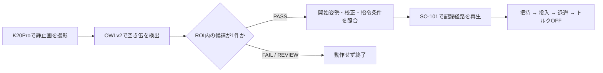

# OWLv2とSO-101による空き缶の回収・分別箱への投入

Physical AI応用1講座の最終課題「AI×ロボティクスによる創造的タスクの実現」として、カメラ画像から空き缶を認識し、実機ロボットアームで白い箱へ投入するシステムを制作しました。

**固定配置で、K20Proによる撮影 → OWLv2による認識 → SO-101による把持・持上げ・投入・退避を実現しました。** 実行中に缶を手で爪へ合わせる操作やLeaderの操作は行いません。開始前の姿勢合わせと、終了時のトルク解除に備えたアーム支持は人が行います。

## 提出物

| 提出物 | 内容・状況 |
| --- | --- |
| デモ動画 | MP4、79.84秒（約1分20秒）。撮影・ファイル確認済み。**YouTube URLは未登録** |
| ソースコード | 本リポジトリの`src/`、`tests/`、設定・依存関係ファイル。公開設定と提出URLは最終確認前 |
| 説明資料 | 目的・構成・AIの利用・工夫・結果・考察をPDFに整理予定。提出用PDFは未登録 |

課題の10月8日版で指定された「動画1〜3分」の条件を満たす長さです。実機の利用とAI推論のみの利用も課題で認められています。YouTubeへのアップロード、公開GitHub URL、PDFの提出は別途必要です。

## 目的と実現したタスク

机上の空き缶を見つけて回収する作業を題材に、画像認識を実機の行動につなげることを目的としました。家庭や作業場での片付けへの応用を想定した、固定配置での単発回収のデモです。

本実装では、カメラ・缶・箱・ロボットの土台を固定し、缶を決められた印の位置・向きへ置きます。対象の有無はAIで判定し、動作はLeaderを使って記録した経路をFollowerで再生します。任意の場所にある缶へ自動で接近する機能や、連続回収は実装していません。

## システム構成とAIの役割



- **AIモデル：** Googleの学習済み[OWLv2（base-patch16-ensemble）](https://huggingface.co/google/owlv2-base-patch16-ensemble)。追加学習は行わず、ゼロショット物体検出の推論を使用します。
- **入力：** K20Proの640×480画像と、対象を表すテキスト`a soda can`。
- **判定：** スコア閾値0.1以上の検出について、枠の中心がROI `260,210,350,350`に入る候補を数えます。1件ならPASS、0件ならFAIL、複数ならREVIEWです。検出枠全体がROI内にあることは条件にしていません。
- **動作への接続：** `--execute`指定時に、その場で撮影した画像がPASSとなり、実機の開始条件も通過した場合だけ固定経路を再生します。

AIは物体の検出と動作を開始するための候補判定に使用しています。画像座標から関節角度を推定したり、経路を生成したりする構成ではありません。ROIは画像上の領域であり、把持可能な位置や衝突しない範囲を保証しません。

## 工夫した点

1. **実機で成立する最小構成に絞ったこと。** 配置を固定し、認識と記録経路の再生を接続しました。今回の実行にはROS 2、模倣学習、LeRobotDataset、厳密なセンサー同期を必須としていません。
2. **缶の位置合わせに依存した手本を修正したこと。** 初期の再生では缶を手で爪へ寄せる補助が必要でした。缶の位置を印で固定し、缶を動かさずに把持する手本を記録し直しました。
3. **送信指令と実測値を区別したこと。** 手本の全568フレームの送信目標を順に再生し、要所では腕の実測値を手本の観測値と比較します。把持中は缶によって爪が閉じ切らないため、爪の指令値への一致を把持成功の判定に使っていません。
4. **誤った入力や急な目標変化に対処したこと。** 校正ハッシュ、開始姿勢、関節範囲を照合し、目標値の変化量と変化速度を制限します。撮影後の時間制限を設け、古い保存画像からの実動作も拒否します。
5. **結果を追跡できること。** 入力画像、検出結果、認識判定、各関節の指令・観測、到達待ち、トルク解除結果を保存します。映像で確認した動作と、ログが示す制御結果を対応づけています。

## 実験結果

2026年10月17日に、同じ手本を使う2回の撮影・認識・固定再生ログを確認しました。

| 項目 | 初回統合試行 | デモ動画撮影時の試行 |
| --- | --- | --- |
| 保存先 | `outputs/collection_20261017_162018_140582/` | `outputs/demo_20261017_163349/` |
| 認識 | PASS、ROI内候補1件 | PASS、ROI内候補1件 |
| 対象の検出スコア | 0.65192 | 0.70859 |
| 再生した元の経路 | 全568フレームを順番どおり通過 | 同左 |
| 到達待ち | approach／grasp／box／release／retreatの5要所完了 | 同左 |
| 送信ログ数 | 584フレーム | 583フレーム |
| 関節観測区間 | 約64.02秒 | 約63.39秒 |
| 異常・終了 | FAULTなし、全6軸トルクOFF読戻し成功 | 同左 |
| 統合結果 | `replay_completed=true`、終了コード0 | 同左 |
| 実物の動作 | 操作者が補助なしの把持・投入・退避成功、滑り・動作中の机や箱への接触なしを報告 | 動画の抽出フレームで把持・持上げ・投入・退避を確認 |

送信ログには到達待ちなどの追加指令が含まれます。「関節観測区間」は最初と最後の送信フレームに記録した読取り開始時刻の差で、モデル読込みを含む全実行時間や動画の長さではありません。2ログの正常終了を、試行全体の成功率として扱ってはいません。

### デモ動画で確認した内容

ローカル動画：`outputs/camera_check/PXL_20261017_073350878.TS.mp4`

- 再生時間は`ffprobe`で**79.842856秒**と確認しました。MP4形式、縦向き表示1080×1920です。
- 全体を5秒間隔、投入付近の58〜68秒を0.5秒間隔で抽出し、缶の持上げ、箱上への移動、爪を開いての投入、その後の退避を確認しました。
- 確認したフレームに、缶を手で爪へ合わせる操作は見られません。微小な滑りや瞬間的な接触の不在まで断定する確認ではありません。
- 撮影日時と動作内容は`outputs/demo_20261017_163349/`の実行と整合します。映像とログの厳密な時刻同期は行っていません。
- 動画末尾では退避の到達待ち表示が見えます。正常終了と全軸OFFは、対応するログで確認しています。

### 制約と今後の改善

固定した位置・向きの缶を対象とする単発動作です。対象の位置・形状・配置が変わった場合の再現性、成功率、把持力、衝突回避は評価していません。ソフトウェアによる把持成功の自動検出も行っていません。

今後は、配置ずれへの対応、把持成否の検出、条件を揃えた反復試行による成功率評価が課題です。まず固定配置での認識と実機動作を一連で成立させたことを、本課題の成果としています。

## ソフトウェア構成

| ファイル | 役割 |
| --- | --- |
| [recognize_and_replay.py](src/control/recognize_and_replay.py) | 撮影・認識・判定・固定再生を1回実行する入口 |
| [detect_objects.py](src/vision/detect_objects.py) | OWLv2推論、検出画像と判定結果の保存 |
| [validate_detection.py](src/vision/validate_detection.py) | ROI・ラベル・スコアによる候補判定 |
| [guarded_replay.py](src/control/guarded_replay.py) | 開始姿勢照合、全経路の再生、要所の到達待ち、終了処理 |
| [guarded_teleop.py](src/control/guarded_teleop.py) | Leaderによる手本の記録、目標値の段階追従 |
| [review_teleop.py](src/control/review_teleop.py) | 手本の関節推移図・CSV・姿勢候補の作成 |
| [action_guard.py](src/control/action_guard.py) / [motion_guard.py](src/control/motion_guard.py) | 関節範囲、指令の変化量・速度・時間の検査 |
| [safe_record_loop.py](src/control/safe_record_loop.py) | 観測・検査・指令送信の順序とFAULTの管理 |
| [diagnostic_camera.py](src/control/diagnostic_camera.py) / [capture_image.py](src/vision/capture_image.py) | カメラ設定照合・静止画保存 |
| [tests/](tests/) | 模擬バス・保存画像等による検証 |

LeRobotDatasetの保存・隔離などの補助実装もリポジトリに残していますが、提出デモの実行経路には使用していません。

## 実行環境

| 項目 | 確認済み環境 |
| --- | --- |
| OS | Windows 11 + WSL2 Ubuntu 24.04 |
| Python | 3.12、`.venv` |
| ロボット | SO-101 Leader / Follower、LeRobot 0.6.1 |
| AIライブラリ | Transformers 5.5.4、PyTorch 2.11.0+cu130、TorchVision 0.26.0+cu130 |
| カメラ | HK 1080P K20Pro、`/dev/video0` |
| 撮影設定 | MJPG、640×480、30 fps設定、AF OFF、手動フォーカス230 |
| 依存管理 | [pyproject.toml](pyproject.toml)、`uv.lock`、[requirements.txt](requirements.txt) |

依存環境を用意する場合は、リポジトリのルートで以下を使用します。`requirements.txt`にはTransformersが含まれていないため、確認済みバージョンを明示して追加します。新規環境での再構築そのものは今回の検証対象外です。

```bash
uv sync --frozen
uv pip install --python .venv/bin/python \
  --extra-index-url https://download.pytorch.org/whl/cu130 \
  -r requirements.txt 'transformers==5.5.4'
```

OWLv2の初回実行ではモデルの取得が必要です。カメラ操作には`v4l2-ctl`が必要で、Windows側から対象USB機器をWSLへ接続した状態で使用します。

## 実行手順

### 前提と入力データ

以下は今回確認した機体・校正・配置での手順です。別の機体へ校正や経路をそのまま適用する手順ではありません。両アームの土台を固定し、缶の置き位置・向きに印を付け、白い箱とカメラの配置を保ちます。

| 入力 | パス |
| --- | --- |
| 手本ログ | `outputs/stationary_can_20261017_155438.jsonl` |
| 要所の姿勢候補 | `outputs/motion_review_stationary_can_20261017_155438/selected_poses.json` |
| Follower校正 | `configs/calibration_snapshots/my_follower_for_004.json` |
| 校正SHA-256 | `820904e1ad9fe22bd4d3a50bcc1e25eb7e76c49b070ee44fd7eca4ad7e76f1d8` |

**`outputs/`はGit管理対象外です。** 動画・実行ログ・手本・姿勢候補はローカル成果物のため、リポジトリをcloneしただけでは実機再生の入力は揃いません。同じ実行を再現するには対応する入力ファイルが必要です。自分の機体で手本を作る場合は`guarded_teleop.py`と`review_teleop.py`を使用します。

### 1. 開始姿勢を合わせる（読取りのみ）

WSLでリポジトリのルートを開き、`FOLLOWER_PORT`を実機のFollowerのby-idパスへ置き換えます。缶を一時的に外し、トルクOFFのアームの重さを手や支えで受けながら合わせます。

```bash
FOLLOWER_PORT='/dev/serial/by-id/<Followerのby-id名>'

.venv/bin/python -m src.control.guarded_replay \
  --source-log outputs/stationary_can_20261017_155438.jsonl \
  --checkpoints outputs/motion_review_stationary_can_20261017_155438/selected_poses.json \
  --calibration configs/calibration_snapshots/my_follower_for_004.json \
  --expected-sha256 820904e1ad9fe22bd4d3a50bcc1e25eb7e76c49b070ee44fd7eca4ad7e76f1d8 \
  --port "$FOLLOWER_PORT" \
  --watch-start \
  --watch-duration-s 120
```

「開始姿勢が3回連続で許容差内です」の表示を確認します。このコマンドは位置指令・トルク操作を行わず、自動でアームを保持しません。表示時間が終了しただけの場合は、開始姿勢が一致したとは限りません。

### 2. 撮影・認識から回収を1回実行する

缶を印の位置・向きへ戻し、同じターミナルで実行します。デモ動画を撮影する場合は、別のカメラやスマートフォンで録画を開始してから実行します。

```bash
.venv/bin/python -m src.control.recognize_and_replay \
  --source-log outputs/stationary_can_20261017_155438.jsonl \
  --checkpoints outputs/motion_review_stationary_can_20261017_155438/selected_poses.json \
  --calibration configs/calibration_snapshots/my_follower_for_004.json \
  --expected-sha256 820904e1ad9fe22bd4d3a50bcc1e25eb7e76c49b070ee44fd7eca4ad7e76f1d8 \
  --port "$FOLLOWER_PORT" \
  --camera /dev/video0 \
  --roi 260,210,350,350 \
  --min-score 0.1 \
  --output-dir "outputs/demo_$(TZ=Asia/Tokyo date +%Y%m%d_%H%M%S)" \
  --execute
```

既定動作は認識のみで、`--execute`を指定した場合だけ実機動作へ進みます。保存画像を指定する`--image`は実動作と併用できません。認識PASSでも、開始姿勢や校正などの照合を通らなければ再生しません。

### 3. 保存結果を確認する

出力先には以下を保存します。動画は外部カメラで撮影した別ファイルです。

```text
outputs/demo_<日時>/
├── camera/frame_000000.png       # 認識に使った静止画
├── recognition/detected.jpg      # 検出枠・ROI付き画像
├── recognition/detections.json   # 検出一覧
├── recognition/detection_gate.json
└── events.jsonl                 # 認識・再生・解除・終了の記録
```

`Collection completed`は処理の終了表示です。認識FAIL／REVIEWで再生を省略した場合もあるため、`recognition_gate`、`replay_attempted`、`replay_completed`とトルクOFFの記録を確認します。実物の把持・投入の成否は映像や操作者の観察で確認します。

### 実機操作上の注意

- 開始姿勢の許容差はF1〜F5が2°、F6が2ポイントです。初期目標を現在位置に設定・読戻ししてからFollowerを有効化します。
- 指令は約10 Hz、各軸最大2°／指令、目標値の変化は最大20°／秒です。F6は0〜100に換算したポイントを使用します。これらは実際の関節速度や衝突安全性を保証する値ではありません。
- 動作中は缶を手で爪へ寄せず、アームの動きを妨げないようにします。終了・中断・FAULTでは全軸トルク解除を試みるため、落下に備えて支持します。
- 通信障害・強制終了などでトルクOFFを確認できない場合は、アームを支持してFollowerの電源を切ります。今回の電源遮断手段はコンセントを抜くことです。FAULT後の自動再開はありません。

## テスト

2026年10月17日の既存テスト実行記録は**525 passed**です。模擬バス等で、認識結果による分岐、校正・開始姿勢・関節範囲、指令の変化量、到達待ち、通信失敗時の解除、保存画像や期限切れ画像からの実動作拒否を検証しました。実機での結果は上の「実験結果」に示しています。

```bash
.venv/bin/python -m pytest tests/ -q
```

テストの合格は、機械的な衝突・過負荷の検出や任意の配置での安全性を保証するものではありません。

## 課題要件との対応・提出状況

提供された「Physical AI応用1講座 最終課題（10/8版）」に基づき整理しています。

| 課題要件 | 本作品の対応 |
| --- | --- |
| AIを何らかの形で使用 | 学習済みOWLv2による物体検出推論を使用。追加学習は実施していない |
| ロボットによるタスク実行 | SO-101実機による空き缶の把持・投入・退避 |
| 1〜3分のMP4動画 | 79.84秒のMP4を確認済み。2倍速を使う場合は動画内または概要欄へ明記 |
| 使用したコード一式 | 本リポジトリ。提出時にGitHubをpublicにし、必要な実装ファイルが含まれることを確認 |
| 概要・目的・工夫等のレポート | 本READMEに整理済み。指定のPDFは別途作成・提出が必要 |

提出開始は2026年10月19日、締切は**2026年11月2日10:00（日本時間）**です。

- [x] デモ動画の撮影と長さの確認
- [x] READMEに目的・AIの利用・工夫・実行手順・結果・考察を整理
- [ ] 説明資料PDF：`説明資料_PAI最終課題_<omnicampusアカウント名>.pdf`
- [ ] YouTubeへアップロードし、URLをREADMEとomnicampusへ記載
- [ ] GitHubのpublic設定・コード一式を確認し、リポジトリURLを提出
- [ ] PDF・GitHub URL・YouTube URLをomnicampusへ提出

YouTubeのタイトルは`PAI最終課題_<omnicampusアカウント名>`、公開設定は少なくとも限定公開とします。課題指定に従い、子ども向け・年齢制限は「いいえ」、インスタントプレミア公開は使用せず、採点完了までは削除・非公開への変更を行いません。予約公開を使う場合は締切までに公開される日時を設定します。

提出物には氏名・所属・メールアドレス等の個人情報や秘密情報を含めず、動画の映り込みも確認します。課題で記載が認められているomnicampusアカウント名を、指定のファイル名・動画タイトルに使用します。
