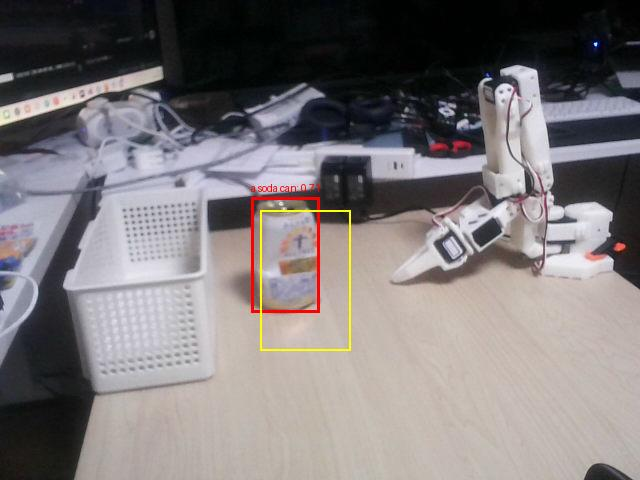

# 最終課題デモの入力・実行記録

2026年10月17日の空き缶回収デモを確認するためのデータです。手本の全568フレーム、5要所の姿勢、使用したFollower校正と、デモ動画撮影時の1回分の結果を収録しています。

## 収録ファイル

| ファイル | 内容・確認できること |
| --- | --- |
| [stationary_can_20261017_155438.jsonl](stationary_can_20261017_155438.jsonl) | Leaderで記録した手本。`frame`の`leader`は要求位置、`sent_target`は送信目標、`observation`は送信前のFollower実測値です |
| [selected_poses.json](selected_poses.json) | approach／grasp／box／release／retreatの5要所。対応する手本フレームは200／266／408／456／568です |
| [calibration/my_follower_for_004.json](calibration/my_follower_for_004.json) | 今回のFollowerの校正値。リポジトリの`configs/calibration_snapshots/my_follower_for_004.json`と同一です |
| [demo_20261017_163349/events.jsonl](demo_20261017_163349/events.jsonl) | 撮影、認識、開始姿勢照合、583送信フレーム、要所の到達確認、トルク解除、終了の記録 |
| [demo_20261017_163349/camera/frame_000000.png](demo_20261017_163349/camera/frame_000000.png) | 認識に使用した640×480の入力画像 |
| [demo_20261017_163349/recognition/detected.jpg](demo_20261017_163349/recognition/detected.jpg) | 検出枠とROIを描画した確認画像 |
| [demo_20261017_163349/recognition/detections.json](demo_20261017_163349/recognition/detections.json) | OWLv2の検出ラベル・スコア・検出枠 |
| [demo_20261017_163349/recognition/detection_gate.json](demo_20261017_163349/recognition/detection_gate.json) | ROI内候補1件、認識PASS、スコア約0.70859の判定結果 |
| [SHA256SUMS](SHA256SUMS) | 上記8ファイルのSHA-256。公開データの内容を照合するために使用します |



## 原本との対応

8ファイルは原本のバイト列を変更せずコピーしています。元の実験記録はローカルに残しています。

| 原本のパス（リポジトリルートから） | このフォルダー内のパス |
| --- | --- |
| `outputs/stationary_can_20261017_155438.jsonl` | `stationary_can_20261017_155438.jsonl` |
| `outputs/motion_review_stationary_can_20261017_155438/selected_poses.json` | `selected_poses.json` |
| `configs/calibration_snapshots/my_follower_for_004.json` | `calibration/my_follower_for_004.json` |
| `outputs/demo_20261017_163349/`配下の5ファイル | `demo_20261017_163349/`配下の同名ファイル |

JSON・JSONL内の`source_log`や画像の`path`には、実行当時の`outputs/...`が残っています。履歴情報として保持しており、確認用コマンドでは下記の公開先を指定します。`events.jsonl`の`source_sha256`・`checkpoints_sha256`・`calibration_sha256`は、収録した手本・姿勢候補・校正ファイルと一致します。

## 実機を接続せずに確認する

以下はすべてリポジトリのルートから実行します。Python環境は[ルートREADME](../../README.md)を参照してください。これらの確認ではカメラ・ロボットへの接続やAIモデルのダウンロード・推論を行いません。

### 1. ファイルのハッシュを照合する

```bash
(cd examples/final_demo && sha256sum -c SHA256SUMS)
```

8ファイルすべてが`OK`になります。

### 2. 記録した動作経路と要所を検査する

```bash
mkdir -p outputs
.venv/bin/python -m src.control.guarded_replay \
  --source-log examples/final_demo/stationary_can_20261017_155438.jsonl \
  --checkpoints examples/final_demo/selected_poses.json \
  --calibration examples/final_demo/calibration/my_follower_for_004.json \
  --expected-sha256 820904e1ad9fe22bd4d3a50bcc1e25eb7e76c49b070ee44fd7eca4ad7e76f1d8
```

既定のプレビューで、568フレームから568指令の計画を作り、`outputs/replay_<日時>.json`へ保存します。校正のハッシュ、関節範囲、要所と手本の一致などを検査します。実機の現在姿勢や物理的な動作の成否を確認する処理ではありません。

### 3. 保存済みの検出結果から認識判定を再計算する

```bash
.venv/bin/python -m src.vision.validate_detection \
  --detections examples/final_demo/demo_20261017_163349/recognition/detections.json \
  --image examples/final_demo/demo_20261017_163349/camera/frame_000000.png \
  --roi 260,210,350,350 \
  --min-score 0.1 \
  --report-json outputs/final_demo_detection_gate.json
```

`ROI candidates: 1`、`Recognition gate: PASS`となります。このCLIは認識PASS時に**終了コード2**を返す仕様です。AI推論をやり直す処理ではなく、保存済みの検出枠・ラベル・スコアから候補を判定します。

## 実行ログの読み方

`events.jsonl`は1行につき1件のJSONを記録しています。

- `recognition`：`recognition_gate=PASS`、`roi_candidates=1`を確認します。
- `start_check`：実行時の開始姿勢が許容差内なら`matched=true`です。
- `frame`：送信目標と関節の観測値を確認できます。到達待ちの追加指令を含むため、手本568フレームに対して583件あります。
- `checkpoint_complete`：approach、grasp、box、release、retreatの順に5件あります。
- `torque_off`：`verified`に全6軸があり、`unconfirmed`と`failures`は空です。
- 最後の`collection_complete`：`replay_attempted=true`、`replay_completed=true`、`replay_returncode=0`です。

`detection_gate.json`の`robot_execution_allowed=false`は、画像の認識判定だけでは実機の動作を許可しないという意味です。統合プログラムは認識PASSに加えて撮影からの経過時間・校正・開始姿勢などを照合し、明示的な実行指定がある場合に再生します。同様に、姿勢候補の`execution_ready=false`やログの`grasp_verified=false`は、候補抽出や制御ログだけでは実機動作・把持成功を保証していないことを示します。

手本内の`guide`は操作者向けの時間案内で、実際の到達確認ではありません。`leader_limit_warning`は関節範囲の端付近を知らせる記録で、FAULTとは区別します。

実物の把持・投入・退避は動画で確認する必要があります。動画MP4はこのフォルダーには含めず、提出用YouTube URLは[ルートREADME](../../README.md)で管理します。校正・経路は今回の機体と固定配置用です。実機での実行条件と手順もルートREADMEを参照してください。
